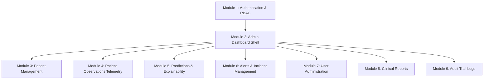
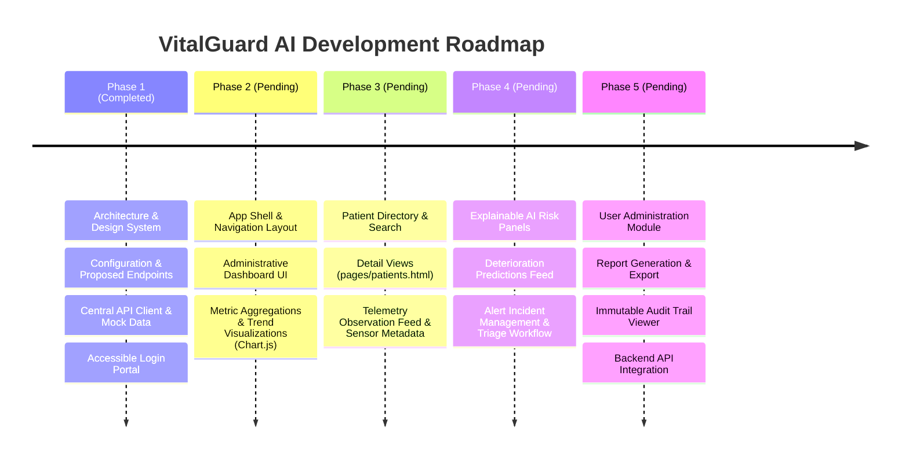

# VitalGuard AI — Master Application Specification (MASTER_SPEC.md)

**Document Version**: 1.0.0-PROPOSED  
**Status**: APPROVED ARCHITECTURE & IMPLEMENTATION SPECIFICATION  
**Last Updated**: October 2026  
**System Title**: VitalGuard AI — An Explainable AI-Based Early Warning System for Patient Health Deterioration  

---

## 1. Executive Summary & Project Purpose

### 1.1 Purpose
**VitalGuard AI** is conceived as an Explainable Artificial Intelligence (XAI) clinical decision-support and early-warning web platform designed for healthcare administrators, clinical teams, and compliance auditors. Its objective is to provide timely, interpretable notifications regarding acute patient deterioration risks using continuous physiological telemetry feeds and predictive models.

### 1.2 Core Disclaimer & Simulation Mandate
> [!CAUTION]
> **SIMULATION & RESEARCH NOTICE**:
> VitalGuard AI is an academic and architectural demonstration platform. All patient identities, clinical telemetry data, predictive risk indices, and audit records specified or generated within this system are **100% synthetic and fictional**.
> - Every simulated record must contain the attribute `source: "simulated"`.
> - Sample values are **NOT** clinically validated.
> - The application does not execute real-time biological calculations or live clinical triage.
> - Sample data and predictions must **NEVER** be utilized for actual diagnostic or therapeutic clinical decisions.

---

## 2. Technology Constraints & Architecture

### 2.1 Technology Stack
The application frontend is intentionally engineered to be lightweight, modular, standards-compliant, and executable without heavy build systems:

* **Markup**: HTML5 using strict semantic landmarks (`<header>`, `<nav>`, `<main>`, `<section>`, `<aside>`, `<footer>`).
* **Styling**: Pure CSS3 utilizing native CSS Custom Properties (variables), Flexbox, CSS Grid, and media queries.
* **Scripting**: Vanilla JavaScript (ES5/ES6 baseline compatibility). Script modules are structured as classic JavaScript files loaded with explicit script dependency ordering to support local static serving.
* **CDN Libraries (Restricted)**:
  * Google Fonts (*Inter* typography).
  * *Chart.js* (via CDN, reserved strictly for Phase 2+ telemetry and risk trend visualization).
  * *Lucide Icons* (via CDN or embedded SVG, as needed in downstream phases).
* **Excluded Technologies**:
  * No front-end frameworks (React, Angular, Vue, Svelte).
  * No utility/CSS frameworks (Bootstrap, Tailwind CSS).
  * No build-step toolchains or package managers (Webpack, Vite, npm, yarn) required for standard runtime execution.

### 2.2 Local Execution Contract
The application must execute natively and load all assets cleanly when served via Python's built-in HTTP server:
```bash
python -m http.server 5500
```
Local URLs:
* Entry redirect: `http://localhost:5500/` or `http://localhost:5500/index.html`
* Login portal: `http://localhost:5500/login.html`

---

## 3. User Roles & Permission Model

The platform defines three primary operational user roles. Client-side permission checks serve as UI navigation filters, while a future production backend will enforce access control at the API level.

| User Role | Description | Proposed Demonstration Permissions |
| :--- | :--- | :--- |
| **System Administrator** | Technical administrator responsible for system health, user provisioning, access policies, and audit review. | `view:dashboard`, `view:patients`, `view:alerts`, `update:alerts`, `view:users`, `manage:users`, `view:reports`, `view:audit_logs` |
| **Authorized Healthcare Staff** | Clinicians, nursing officers, and telemetry monitors reviewing patient risk trends and acknowledging alerts. | `view:dashboard`, `view:patients`, `view:alerts`, `update:alerts`, `view:reports` |
| **Read-only Reviewer** | Quality assurance, medical researchers, and external auditors evaluating predictive explainability and compliance. | `view:dashboard`, `view:patients`, `view:alerts`, `view:reports`, `view:audit_logs` (read-only) |

---

## 4. Proposed Application Modules (Functional Scope)

The VitalGuard AI Admin Web Application is structured into nine core architectural modules.



### Module 1: Authentication & Authorization (Phase 1 Scope)
* **Description**: Secure credential intake, credential validation against the centralized API client, demo session persistence in `sessionStorage`, role resolution, and route guarding.
* **Key Features**:
  * Dedicated `login.html` with form validation and password reveal toggle.
  * Simulation mode banner and quick-fill demo account credentials when `MOCK_MODE === true`.
  * Safe session termination (`logout()`) and route guard helper (`requireAuth()`).

### Module 2: Admin Dashboard (Proposed — Phase 2)
* **Description**: High-level operational command center providing real-time aggregation of synthetic cohort telemetry, active critical alerts, ward bed occupancy, and model inference statistics.
* **Proposed Features**:
  * Cohort metrics summary tiles (Total Monitored, Critical Deterioration Alerts, Active Observations).
  * High-risk patient triage feed.
  * Trend charts (Chart.js) showing simulated cohort vital distributions.

### Module 3: Patient Management (Proposed — Phase 3)
* **Description**: Roster of monitored individuals, ward assignments, admission timestamps, and demographic summaries.
* **Proposed Features**:
  * Searchable, filterable patient table (`PT-1001` through `PT-1025`).
  * Detail view for individual patient records (`/admin/patients/{id}`).
  * Synthetic demographic overview and admission history.

### Module 4: Patient Observations & Vital Signs Telemetry (Proposed — Phase 3)
* **Description**: Continuous physiological telemetry ingest and observation log.
* **Proposed Features**:
  * Telemetry recordings for Heart Rate (bpm), Blood Pressure (Systolic/Diastolic mmHg), SpO2 (%), Respiratory Rate (breaths/min), and Core Temperature (°C).
  * Tabular vital logs with sorting by timestamp and sensor metadata.

### Module 5: Predictions & Explainability (XAI) (Proposed — Phase 4)
* **Description**: Static simulated predictive deterioration scoring paired with explainability feature weights.
* **Proposed Features**:
  * Static risk category tags: `Low`, `Moderate`, `High`, `Critical`.
  * Simulated feature contribution indicators (e.g., elevated heart rate + drop in SpO2 contributing to deterioration score).
  * Strict academic disclaimers declaring scores as pre-written demonstration values without biological derivation.

### Module 6: Alerts & Incident Management (Proposed — Phase 4)
* **Description**: Triage and lifecycle workflow for clinical threshold alerts.
* **Proposed Features**:
  * Severity levels: `Critical`, `High`, `Warning`, `Info`.
  * Alert lifecycle states: `Active` → `Acknowledged` → `Resolved`.
  * Staff acknowledgment attribution via `PATCH /admin/alerts/{id}`.

### Module 7: User Management (Proposed — Phase 5)
* **Description**: Administrative oversight of user identities, staff departments, and active role assignments.
* **Proposed Features**:
  * Staff directory viewing (`USR-1001` through `USR-1005`).
  * Role mapping controls for System Administrators.

### Module 8: Clinical Reports (Proposed — Phase 5)
* **Description**: Scheduled and on-demand report generation covering synthetic ward summaries and system diagnostic metrics.
* **Proposed Features**:
  * Export options for cohort statistics in simulated PDF/CSV formats.

### Module 9: Audit Logs (Proposed — Phase 5)
* **Description**: Immutable system log capturing security events, credential evaluations, patient record views, and alert acknowledgments.
* **Proposed Features**:
  * Filterable audit table displaying Timestamp, Actor, Category, Action, IP Address, and Event Metadata.

---

## 5. Proposed Backend API Contracts

> [!NOTE]
> All paths listed below are **PROPOSED API CONTRACTS**. They represent the anticipated REST interface for a future backend service. In mock mode (`MOCK_MODE: true`), all requests are intercepted client-side by `assets/js/mock-data.js`.

### 5.1 Common Request / Response Envelope
All API requests processed via `VitalGuardApi.request(endpoint, options)` return a standardized object:
```javascript
{
  "ok": true,          // boolean: true for 2xx responses
  "data": { ... },     // payload object, array, or null
  "error": null        // string message on failure, null on success
}
```

### 5.2 Endpoint Specifications

| # | Method | Proposed Endpoint | Auth Required | Description / Request & Response Schema |
| :--- | :--- | :--- | :--- | :--- |
| **1** | `POST` | `/auth/login` | No | **Body**: `{ "email": string, "password": string }`<br>**Success (200)**: `{ "user": { "id", "name", "email", "role", "department" }, "token": string, "expiresIn": number }`<br>**Errors**: `400 Bad Request`, `401 Unauthorized` |
| **2** | `GET` | `/users/me` | Yes | **Success (200)**: Profile and role details of the current authenticated identity. |
| **3** | `GET` | `/admin/dashboard` | Yes | **Success (200)**: Aggregate statistics `{ "totalPatients", "activeMonitoring", "totalObservations", "activeAlerts", "criticalAlerts", "systemStatus", "source": "simulated" }`. |
| **4** | `GET` | `/admin/patients` | Yes | **Success (200)**: `{ "items": [ Patient ], "total": 25, "source": "simulated" }`. |
| **5** | `GET` | `/admin/patients/{id}` | Yes | **Success (200)**: Single patient object matching `{id}`.<br>**Error (404)**: If ID is not found in cohort. |
| **6** | `GET` | `/admin/observations` | Yes | **Success (200)**: `{ "items": [ Observation ], "total": 150, "source": "simulated" }`. |
| **7** | `GET` | `/admin/predictions` | Yes | **Success (200)**: Array of static simulated risk predictions. |
| **8** | `GET` | `/admin/alerts` | Yes | **Success (200)**: Array of clinical incident alerts. |
| **9** | `PATCH` | `/admin/alerts/{id}` | Yes | **Body**: `{ "status": "Acknowledged"|"Resolved", "acknowledgedBy": string }`<br>**Success (200)**: Updated alert object. |
| **10**| `GET` | `/admin/users` | Yes | **Success (200)**: System user roster. |
| **11**| `GET` | `/admin/reports` | Yes | **Success (200)**: Available synthetic summary reports. |
| **12**| `GET` | `/admin/audit-logs` | Yes | **Success (200)**: Array of security and operational event logs. |

---

## 6. Design System & Frontend Architecture

### 6.1 Design Tokens (`assets/css/style.css`)
Centralized CSS custom properties governing all visual layers:
* **Primary Navy**: `#0B1F3A` (Dark: `#071527`, Light: `#162E52`)
* **Accent Teal**: `#0E9FA8` (Dark: `#0A7D85`, Light: `#14B8C4`, Tint: `#E6F7F8`)
* **Surfaces**: Light grey page background `#F4F6F9`, white surfaces `#FFFFFF`, borders `#E2E8F0` / `#CBD5E1`.
* **Status Colors**:
  * Critical / Error: `#DC2626` (surface `#FEF2F2`, text `#991B1B`)
  * Warning / Amber: `#D97706` (surface `#FFFBEB`, text `#92400E`)
  * Success / Green: `#16A34A` (surface `#F0FDF4`, text `#166534`)
  * Information / Sky: `#0284C7` (surface `#F0F9FF`, text `#075985`)
* **Typography**: `'Inter', -apple-system, BlinkMacSystemFont, 'Segoe UI', Roboto, sans-serif`.
* **Scales**: Defined scales for spacing (`--space-3xs` through `--space-4xl`), border radii (`--radius-xs` through `--radius-full`), and box shadows (`--shadow-xs` through `--shadow-xl`).

### 6.2 Component Library (`assets/css/components.css`)
Standardized UI building blocks:
* **Buttons**: `.btn-primary`, `.btn-secondary`, `.btn-outline`, `.btn-ghost`, `.btn-block`, `.btn-sm`, `.btn-lg`, disabled states.
* **Form Controls**: `.form-group`, `.form-label`, `.form-control`, `.is-invalid`, `.form-error`, `.input-action-btn` (password visibility).
* **Badges**: Multi-modal status communication (`.badge-info`, `.badge-success`, `.badge-warning`, `.badge-error`, `.badge-neutral`) combining background tint, colored status indicator dot, and explicit text.
* **Alerts & Toasts**: Accessible system alerts with iconography and dismissable toast dispatch system.
* **Accessible Modal Foundation**: Focus-trapped dialog overlay with `role="dialog"`, `aria-modal="true"`, `Escape` key dismissal, and focus restoration.
* **Tables & Loading States**: Fluid responsive tables, `.spinner`, and `.empty-state` patterns.
* **Demo Banner**: Prominent Simulation Mode notification banner.

### 6.3 Accessibility & WCAG Compliance
* **WCAG 2.1 AA Standards**: High text-to-background contrast ratios (minimum 4.5:1 for regular text, 7:1 for headings).
* **Keyboard Navigation**: Distinct, visible `:focus-visible` outline rings (teal accent).
* **Screen Reader Announcers**: Dynamic error states and status changes announced using `aria-live="polite"` and `aria-live="assertive"`.
* **Reduced Motion**: Full support for `@media (prefers-reduced-motion: reduce)` disabling non-essential transitions and animations.
* **Multi-Modal Status**: Status must never be conveyed via color alone; color cues must always be paired with explicit text, icons, or ARIA status text.

### 6.4 Responsive Viewport Standards (`assets/css/responsive.css`)
The application is tested and verified across standard breakpoints without horizontal scrolling:
* **Mobile Small**: 320px
* **Mobile Standard**: 375px
* **Tablet**: 768px
* **Laptop**: 1024px
* **Desktop / Large Display**: 1440px+

---

## 7. Security Architecture & Simulation Governance

1. **Client-Side Storage Disclaimer**: Browser `sessionStorage` is utilized purely to manage prototype UI state and navigation flow. It is **NOT** a secure credential store.
2. **Backend Authentication Obligation**: A future production backend must independently verify credentials via secure HTTPS endpoints and issue cryptographically signed, HTTP-only session cookies or JWT tokens.
3. **No Plaintext Credential Persistence**: Passwords must **never** be persisted to `localStorage`, `sessionStorage`, or unmasked DOM attributes.
4. **DOM Injection Safeguards**: All dynamic content rendering across the application must strictly utilize safe DOM manipulation APIs (`document.createElement`, `element.textContent`, explicit attribute assignment). Dynamic `innerHTML` assignment using untrusted data is strictly forbidden.
5. **Simulated Session Tokens**: Mock tokens must be prefixed as simulation tokens (e.g., `simulated-demo-session-token-...`) so they can never be mistaken for real cryptographic credentials.

---

## 8. Phase 1 Specification (Baseline Architecture & Login Portal)

### 8.1 Scope of Phase 1
Phase 1 establishes the structural, visual, and architectural foundation for the entire application. It includes:
* The Design System CSS architecture (`style.css`, `components.css`, `layout.css`, `dashboard.css`, `responsive.css`).
* The central configuration [`config.js`](file:///c:/Users/saniy/OneDrive/Documents/MINI_PROJECT_SEM%20V/VitalGuard_MP/assets/js/config.js) and proposed endpoints.
* The unified API client [`api.js`](file:///c:/Users/saniy/OneDrive/Documents/MINI_PROJECT_SEM%20V/VitalGuard_MP/assets/js/api.js) supporting mock routing.
* The deterministic mock data provider [`mock-data.js`](file:///c:/Users/saniy/OneDrive/Documents/MINI_PROJECT_SEM%20V/VitalGuard_MP/assets/js/mock-data.js).
* The authentication client [`auth.js`](file:///c:/Users/saniy/OneDrive/Documents/MINI_PROJECT_SEM%20V/VitalGuard_MP/assets/js/auth.js).
* Safe DOM and modal utilities [`utils.js`](file:///c:/Users/saniy/OneDrive/Documents/MINI_PROJECT_SEM%20V/VitalGuard_MP/assets/js/utils.js).
* The accessible healthcare login portal [`login.html`](file:///c:/Users/saniy/OneDrive/Documents/MINI_PROJECT_SEM%20V/VitalGuard_MP/login.html) and interaction logic [`login.js`](file:///c:/Users/saniy/OneDrive/Documents/MINI_PROJECT_SEM%20V/VitalGuard_MP/assets/js/login.js).
* The session routing entry-point [`index.html`](file:///c:/Users/saniy/OneDrive/Documents/MINI_PROJECT_SEM%20V/VitalGuard_MP/index.html).
* An empty `pages/` directory (reserved for Phase 2+ views).

### 8.2 Phase 1 Directory Structure
```text
VitalGuard-AI/
├── index.html                   # Application entry-point and route guard redirector
├── login.html                   # Accessible login interface
├── README.md                    # Operational guide and architecture overview
├── docs/
│   └── MASTER_SPEC.md           # Master project specification (this document)
├── pages/                       # Deliberately empty in Phase 1
└── assets/
    ├── css/
    │   ├── style.css            # Base tokens, reset, typography, and accessibility
    │   ├── components.css       # Reusable UI component library
    │   ├── layout.css           # Authentication layout and app shell skeleton
    │   ├── dashboard.css        # Minimal foundation placeholder for Phase 2
    │   └── responsive.css       # Breakpoints from 320px to 1440px
    ├── js/
    │   ├── config.js            # Configuration, MOCK_MODE flag, proposed endpoints
    │   ├── api.js               # Central request client with mock routing
    │   ├── mock-data.js         # Deterministic mock provider (25 patients, 150 vitals)
    │   ├── auth.js              # Session manager, role mappings, and route guard
    │   ├── utils.js             # Safe DOM builders, formatters, and modal helpers
    │   └── login.js             # Form validation, error handling, and login interaction
    └── images/
        └── vitalguard-logo.svg  # Original SVG emblem
```

### 8.3 Phase 1 Verification Checklist
1. All 16 required files exist at specified paths.
2. The `pages/` directory remains strictly empty.
3. CSS and JavaScript files are completely separated.
4. No JavaScript syntax errors or uncaught runtime exceptions occur.
5. All local assets (SVG logo, stylesheets, scripts) resolve cleanly via HTTP.
6. The login page loads cleanly in mock mode with the Simulation Mode banner visible.
7. All three demo accounts authenticate successfully:
   * System Administrator (`admin@demo.vitalguard.test` / `Demo@12345`)
   * Healthcare Staff (`staff@demo.vitalguard.test` / `Staff@12345`)
   * Read-only Reviewer (`reviewer@demo.vitalguard.test` / `Review@12345`)
8. Incorrect credentials return friendly, non-sensitive error notifications.
9. Empty submissions trigger accessible inline validation errors (`aria-invalid="true"`).
10. Malformed emails are caught by format validation before submission.
11. Password visibility toggle switches input type, updates `aria-pressed`, and preserves focus.
12. Loading indicators activate during authentication and disable duplicate submissions.
13. Session logout cleanly removes demo credentials from `sessionStorage`.
14. Unauthenticated visits to `index.html` redirect to `login.html`.
15. Authenticated visits to `index.html` target `pages/dashboard.html` per redirect contract.
16. Mock API requests return the `{ ok, data, error }` response schema.
17. Every synthetic record contains `source: "simulated"`.
18. There are exactly 25 synthetic patient records (`PT-1001` - `PT-1025`).
19. There are exactly 150 synthetic observation records (`OBS-1001` - `OBS-1150`).
20. Zero instances of unsafe dynamic `.innerHTML =` exist in the JavaScript codebase.
21. The application serves and runs successfully using `python -m http.server 5500`.

---

## 9. Multi-Phase Development Roadmap

The application architecture is structured for sequential execution across five discrete phases:



* **Phase 1 (Completed)**: Core Design System, Central API Client, Deterministic Mock Data, Authentication Service, Accessible Login Page.
* **Phase 2 (Proposed)**: Application Shell with responsive sidebar navigation, Topbar, and the Administrative Dashboard (`pages/dashboard.html`).
* **Phase 3 (Proposed)**: Patient Directory (`pages/patients.html`), Patient Details (`pages/patient-detail.html`), and Observation Telemetry Logs (`pages/observations.html`).
* **Phase 4 (Proposed)**: Predictions & Explainability View (`pages/predictions.html`) and Alert Incident Management (`pages/alerts.html`).
* **Phase 5 (Proposed)**: System User Management (`pages/users.html`), Reports (`pages/reports.html`), Audit Trail Logs (`pages/audit-logs.html`), and Live Backend Integration.

---

## 10. Status of Implementation

| Component / Layer | Status | Implementation Details |
| :--- | :--- | :--- |
| Design System Tokens (`style.css`) | **Implemented (Phase 1)** | Variables for colors, spacing, typography, focus, and reduced-motion. |
| Reusable Component Styles (`components.css`) | **Implemented (Phase 1)** | Buttons, inputs, badges, cards, alerts, toasts, modal foundation. |
| Layout & App Shell Skeleton (`layout.css`) | **Implemented (Phase 1)** | Auth card layout and app-shell CSS foundation. |
| Dashboard Styles (`dashboard.css`) | **Foundation Only** | Structural grid placeholder reserved for Phase 2. |
| Responsive Styles (`responsive.css`) | **Implemented (Phase 1)** | 320px to 1440px viewport adaptations. |
| SVG Brand Emblem (`vitalguard-logo.svg`) | **Implemented (Phase 1)** | Clinical shield with ECG waveform and AI neural node. |
| Central Configuration (`config.js`) | **Implemented (Phase 1)** | `MOCK_MODE: true`, `API_BASE_URL`, 12 proposed endpoints. |
| Mock Data Provider (`mock-data.js`) | **Implemented (Phase 1)** | 25 simulated patients, 150 vitals, router handler. |
| API Request Client (`api.js`) | **Implemented (Phase 1)** | Unified request helper, timeout, status handling, mock interception. |
| Authentication Client (`auth.js`) | **Implemented (Phase 1)** | Login, logout, permission checks, route guard. |
| Safe DOM Utilities (`utils.js`) | **Implemented (Phase 1)** | `createElement`, formatters, debounce, toasts, accessible modal helper. |
| Login Page (`login.html` & `login.js`) | **Implemented (Phase 1)** | Accessible login interface with validation and Phase 1 completion view. |
| Entry Point Redirect (`index.html`) | **Implemented (Phase 1)** | Route guard redirect contract to `login.html` or `pages/dashboard.html`. |
| Dashboard Page (`pages/dashboard.html`) | **Not Implemented (Phase 2)** | Intentionally deferred to Phase 2 per specification boundary. |
| Operational Pages (`pages/*.html`) | **Not Implemented (Phase 3-5)**| Patient, telemetry, prediction, alert, user, report, and audit pages. |
| Real Backend Service | **Not Implemented (Proposed)** | Awaiting backend API server implementation. |
